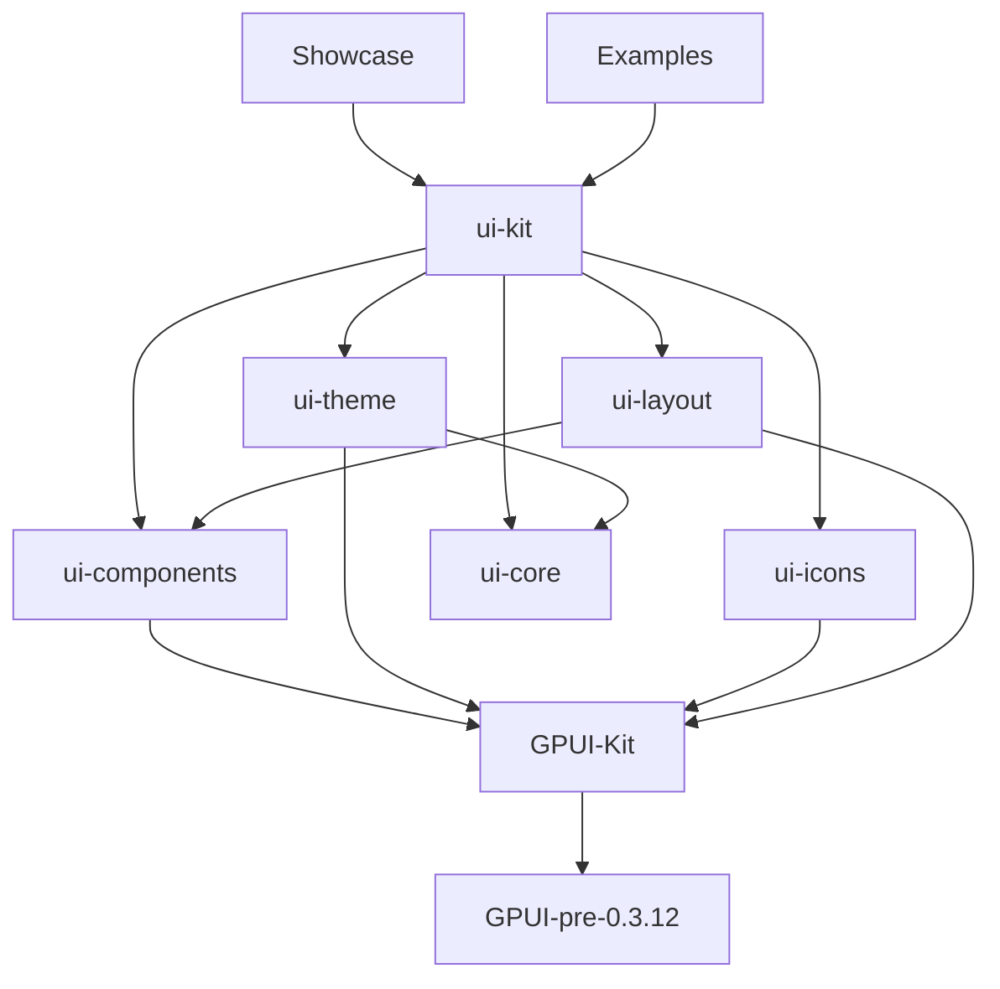

# Architecture

The dependency graph points from applications toward reusable foundations. No library depends on Showcase. There is one GPUI runtime and one upstream component implementation.

| Library | Owns | Does not own |
| --- | --- | --- |
| ui-core | ThemeMode and Density | GPUI objects or components |
| ui-components | Stable route to the pinned component modules | Copied components or renamed wrappers |
| ui-theme | ThemeDefinition, validation, ThemeRegistry, ThemeService, token source | Rendering or another component theme engine |
| ui-icons | IconId, semantic IconName, validation, SVG asset selection | SVG rasterization |
| ui-layout | Application regions, responsive composition, configuration | Resize arithmetic or docking behavior |
| ui-kit | Re-exports and curated prelude | Business logic or implementations |

ThemeService resolves repository configuration through GPUI Kit's SemanticThemeConfig and applies it through Theme::update, which synchronizes Base and refreshes windows. Its retained complete semantic snapshot supplies application scale overrides that upstream legacy storage cannot retain. This is a projection of one configuration, not a second renderer theme.

Inputs, selection and sliders remain native entities retained by Showcase. Ordinary booleans are controlled by the owning view. Subscriptions are stored for that entity's lifetime. Every mutation that changes visible content notifies GPUI. Icons are small static byte assets accepted by upstream Icon::data. All standard controls come through ui-components.

AppShell is a stateless RenderOnce composition. Optional regions accept IntoElement and are lowered to AnyElement at ownership boundaries. SplitWorkspace delegates to upstream resizable_panel and h_resizable. Panel sizing persists while its keyed layout remains mounted. ShellConfig validates serialized configuration; application storage and multiwindow persistence are not imposed on consumers.

The workspace root is the requested project directory, rather than adding a redundant rust-ui-kit subdirectory. Empty directories and unused font bundles were not generated.

A temporary crates.io source override carries one functional GPUI Base 0.9.1 drag-start fix, with the original source and a complete patch at vendor/gpui-base. It is excluded from workspace membership and checked by the dependency validator. This preserves upstream ownership of panel behavior while handling coalesced native input. See compatibility.md before updating or removing it.
